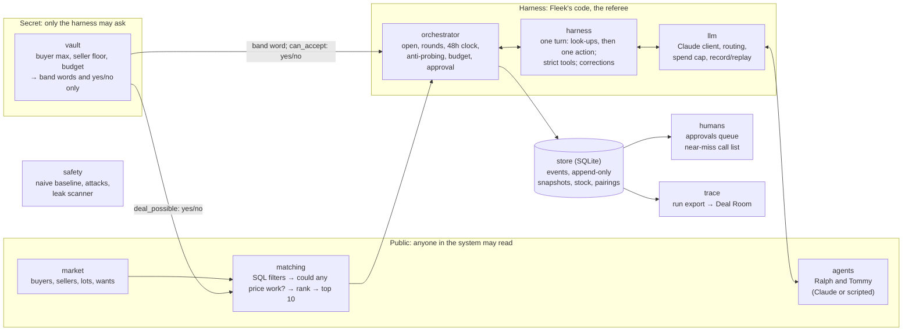

# Architecture

**One line:** the AI decides what to offer; code decides what's allowed; the secret limits never go
into the AI.

## The pieces

The arrows out of the vault carry **only band words or True/False**. Three import rules, checked
in CI by import-linter, make the boundary structural rather than a convention:

| Rule | Why |
|---|---|
| `agents` and `llm` never import `vault`, directly or indirectly | Code that talks to the model can't hold a secret |
| `domain` never imports `store` or `vault` | The core types stay plain data and rules |
| `trace` never imports `vault` | An exported run file can't carry a secret |

## Who knows what

| | Knows | Never knows |
|---|---|---|
| **Ralph** (buyer's agent) | the lot's public facts, the buyer's request, every card, cards left, his other open deals, a band word for one price per round | the buyer's max or budget, the seller's floor |
| **Tommy** (seller's agent) | the lot's public facts, every card, cards left, a band word for one price per round | the seller's floor, anything about the buyer's limits |
| **The harness** | everything: it asks the vault yes/no questions before any card or accept | — |
| **Account managers** | deals waiting for approval and why; near misses (prices both sides saw) | the secret limits |

Agents talk to each other only through **offer cards**: price, bundles, prepaid, ship-by date and
up to three fixed reason codes. A card has no text field, so an instruction can't travel from one
agent to the other.

## The life of one deal

1. **Match.** SQL filters (category, brand, grade, stock, bundle size) narrow 1,494 lots to about
   62 per buyer. The vault drops the ones where no price can work (about 47 left). Similarity
   ranking picks the top 10. Claude Ralph can pick 3 of them to negotiate at once (the
   three-deal run); `fleek negotiate` and the simulation negotiate the top one.
2. **Open.** `open_negotiation()` records the buyer and lot, refusing a second live negotiation for
   the same pair and a retry within 24 hours of a failed one.
3. **Turns.** Each turn is a fresh conversation for one agent: a playbook, a short summary, its
   tools. It may look up facts and check one price's band, then must take exactly one action:
   offer or counter, accept, or walk away. Wrong output gets a correction; repeated wrong output,
   a refusal or the spend cap hands the negotiation to a person, with the reason recorded.
4. **Every move is checked by code before it happens:**
   - a card past its sender's own limit is never sent;
   - concessions only go one way (buyer up, seller down);
   - a buyer's move must fit their budget across all their open deals (offers are binding);
   - an accept must be inside both limits (`can_accept`).
5. **Accept.** One transaction takes the stock (only if enough is left), records the accept, and
   tells every rival negotiation on a sold-out lot that it's gone.
6. **Approve.** Deals of £1,500 or more, and a buyer's first 3, wait for a person; others are
   approved by the rule. Rejected or expired approvals put the stock back on sale.

Every move is one event in an append-only log (the database refuses edits and deletes). Replaying
the log rebuilds each negotiation exactly; the saved state is checked against a replay in tests.

## Where things live

| Package | What's in it |
|---|---|
| `domain` | Money in whole pence, Fleek's fees, lots, offer cards, the state machine, events, replay |
| `vault` | `SecretMoney`, mandates, bands, yes/no checks, budget across deals, the seeded secrets |
| `market` | The seeded fake market: 500 buyers, 50 sellers, 1,494 lots |
| `matching` | The funnel: SQL filters, "could any price work?", local embeddings and ranking |
| `store` | SQLite: append-only events, snapshots, stock and the atomic accept, pairings |
| `orchestrator` | Opening, rounds and the clock, the turn-by-turn runner, approval |
| `harness` | The tool loop, strict schemas, the agents' tools, escalation to a person |
| `llm` | The Claude client, model routing, spend caps, record and replay |
| `agents` | The `Agent` interface, scripted Ralph and Tommy, Claude Ralph and Tommy, picking 3 lots |
| `humans` | The account managers' near-miss call list |
| `safety` | The naive baseline, attacks, the leak detector and scanner, the safety report |
| `evals` | The market simulation |
| `trace` | Exporting a run as JSON |
| `config.py` + `market.toml` | Every number we expect to tune |

## Choices worth knowing

- **Whole pence, never floats.** £13.50 at 5% off is £12.83; floats give £12.82. At a secret limit
  a penny decides whether a deal is allowed.
- **SQLite with an append-only log.** One file, no server, runs from the README. At scale: Postgres
  with the same tables, the same conditional updates, and an app user that can only read and insert
  events.
- **Our own tool loop, not the SDK's runner.** Every tool call passes our checks: one action per
  turn, a look-up limit, corrections, an append-only conversation.
- **Strict tool schemas plus Pydantic.** The API enforces each input's shape; Pydantic checks the
  limits strict mode can't express; failures go back to the model as corrections.
- **Record and replay.** Live Claude runs are recorded once; tests and CI replay them with no key.
- **No vector database yet** (decision 002): ranking all lots for all 500 buyers takes 46 ms in
  NumPy.

Decisions: [001, secrets never enter the model](decisions/001-secrets-never-enter-the-model.md) ·
[002, no vector database yet](decisions/002-no-vector-database-yet.md). Results:
[EVALS.md](EVALS.md). Assumptions: [ASSUMPTIONS.md](ASSUMPTIONS.md).
